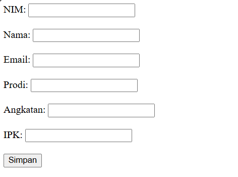
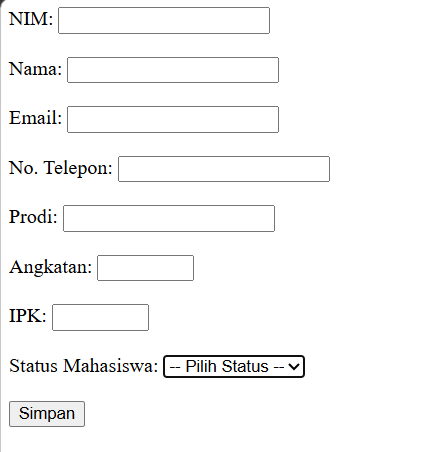
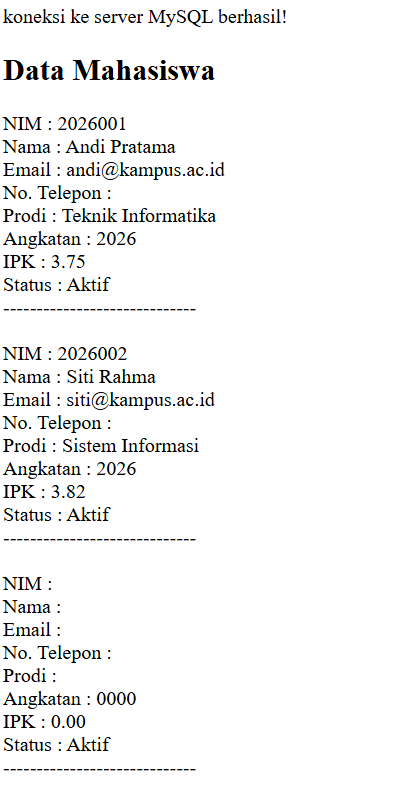

# Tugas Pertemuan 5 Praktikum PBW

**Nama:** Muhammad Hafiz Saputra

**NPM:** 4524210115

## Modifikasi Program Data Mahasiswa

### Modifikasi 1

Menambahkan field `no_telepon` pada form mahasiswa untuk menyimpan nomor telepon mahasiswa.

### Modifikasi 2

Menambahkan field `status_mahasiswa` berupa pilihan `Aktif`, `Cuti`, dan `Lulus`.

### Modifikasi 3

Menambahkan validasi IPK pada `form.php` dan `simpan.php` agar nilai IPK hanya berada pada rentang 0 sampai 4.

### Modifikasi 4

Menambahkan validasi status mahasiswa pada `simpan.php` agar data yang disimpan hanya memiliki status `Aktif`, `Cuti`, atau `Lulus`.

### Penjelasan 5 Bagian Kode Penting

1. **Form Input Data Mahasiswa**

   Digunakan untuk membuat form yang mengirimkan data mahasiswa ke `simpan.php` menggunakan metode POST.

   ```php
   <form action="simpan.php" method="post">
   ```

2. **Input No. Telepon**

   Digunakan untuk menerima nomor telepon mahasiswa dari pengguna.

   ```php
   <input type="text" name="no_telepon" maxlength="15" required>
   ```

3. **Input Status Mahasiswa**

   Digunakan untuk memberikan pilihan status mahasiswa berupa Aktif, Cuti, dan Lulus.

   ```php
   <select name="status_mahasiswa" required>
       <option value="">-- Pilih Status --</option>
       <option value="Aktif">Aktif</option>
       <option value="Cuti">Cuti</option>
       <option value="Lulus">Lulus</option>
   </select>
   ```

4. **Validasi IPK dan Status**

   Digunakan untuk memastikan nilai IPK berada pada rentang 0 sampai 4 dan status mahasiswa sesuai dengan pilihan yang telah ditentukan.

   ```php
   if ($ipk < 0 || $ipk > 4) {
       die("IPK harus berada di antara 0 sampai 4.");
   }

   $status_valid = ['Aktif', 'Cuti', 'Lulus'];

   if (!in_array($status_mahasiswa, $status_valid)) {
       die("Status mahasiswa tidak valid.");
   }
   ```

5. **Menyimpan dan Menampilkan Data**

   Digunakan untuk menyimpan data mahasiswa ke database dan menampilkan data `no_telepon` serta `status_mahasiswa`.

   ```php
   $query = mysqli_query(
       $koneksi,
       "INSERT INTO mahasiswa
       (nim, nama, email, no_telepon, prodi, angkatan, ipk, status_mahasiswa)
       VALUES
       ('$nim', '$nama', '$email', '$no_telepon', '$prodi', '$angkatan', '$ipk', '$status_mahasiswa')"
   );
   ```

   Data kemudian ditampilkan menggunakan query:

   ```php
   $query = mysqli_query($koneksi, "SELECT * FROM mahasiswa");

   while ($data = mysqli_fetch_assoc($query)) {
       echo "No. Telepon : " . $data['no_telepon'];
       echo "<br>";

       echo "Status : " . $data['status_mahasiswa'];
       echo "<br>";
   }
   ```

## Screenshot

### Screenshot Sebelum Modifikasi




### Screenshot Sesudah Modifikasi





## Error yang Pernah Muncul

### Error

```text
Duplicate entry '2026001' for key 'nim'
```

### Penyebab

Error terjadi ketika memasukkan data mahasiswa dengan NIM yang sama dengan data yang sudah tersimpan di database. Field `nim` pada tabel `mahasiswa` memiliki sifat `UNIQUE`, sehingga satu NIM tidak dapat digunakan untuk lebih dari satu data mahasiswa.

### Langkah Perbaikan

Saya mengecek kembali NIM yang akan dimasukkan dan memastikan NIM tersebut belum digunakan oleh mahasiswa lain. Setelah menggunakan NIM yang berbeda, data mahasiswa dapat disimpan ke dalam database dengan benar.