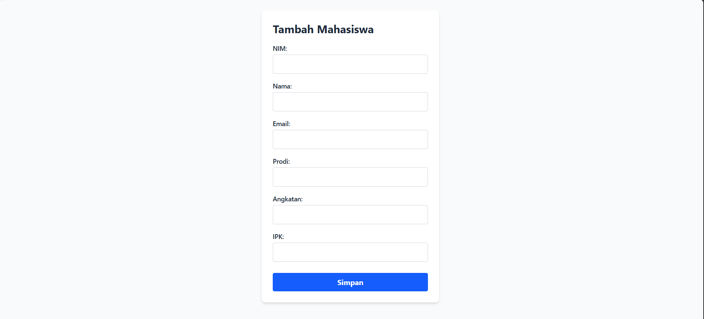
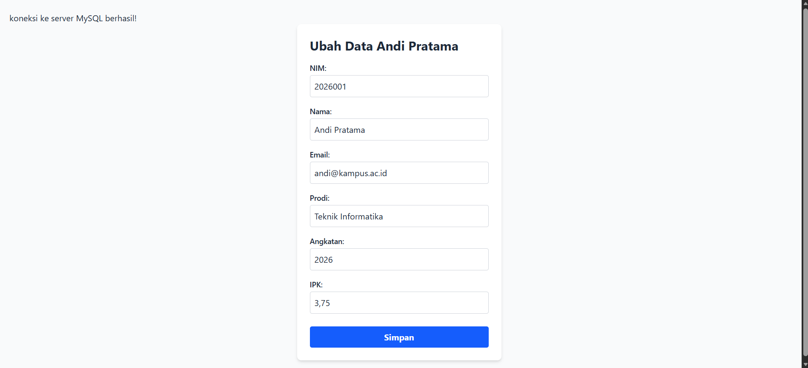
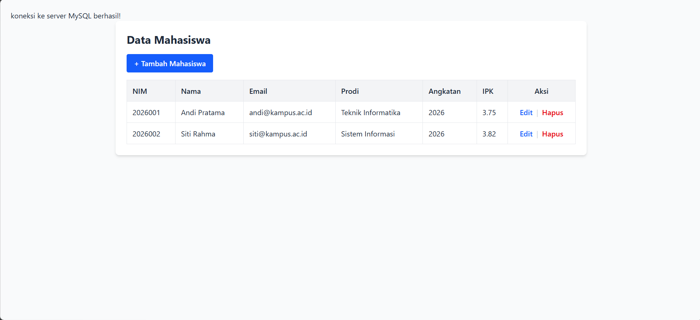
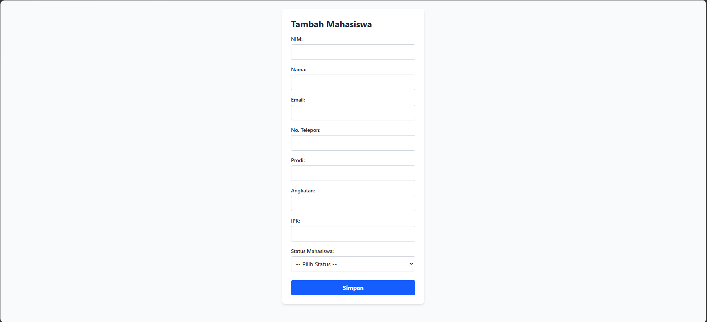
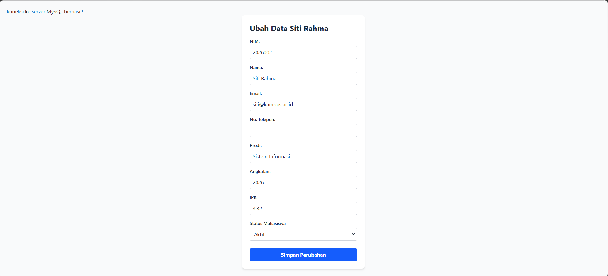
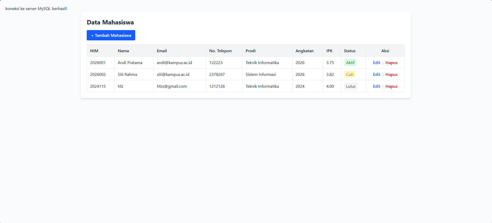

# Tugas 6 Praktikum PBW

**Nama:** Muhammad Hafiz Saputra

**NPM:** 4524210115

## Modifikasi Program CRUD Data Mahasiswa

### Modifikasi 1
Menambahkan field `no_telepon` pada form tambah dan edit data mahasiswa serta menampilkannya pada halaman index.

### Modifikasi 2
Menambahkan field `status_mahasiswa` dengan pilihan `Aktif`, `Cuti`, dan `Lulus` pada proses tambah dan edit data mahasiswa.

### Modifikasi 3
Menambahkan validasi IPK agar nilai yang dimasukkan berada pada rentang 0 sampai 4 dan validasi angkatan agar berada pada rentang 2000 sampai 2100.

### Modifikasi 4
Menambahkan tampilan status mahasiswa pada halaman index serta menambahkan konfirmasi sebelum data dihapus.

### Penjelasan 5 Bagian Kode Penting

1. **Form Create**
   
   File `create.php` digunakan untuk memasukkan data mahasiswa baru. Form berisi NIM, nama, email, nomor telepon, prodi, angkatan, IPK, dan status mahasiswa.

2. **Proses Penyimpanan Data**
   
   File `store.php` digunakan untuk menerima data dari `create.php`, melakukan validasi data, kemudian menyimpan data mahasiswa ke database menggunakan perintah `INSERT`.

3. **Menampilkan Data Mahasiswa**
   
   File `index.php` digunakan untuk mengambil dan menampilkan data mahasiswa dari database dalam bentuk tabel. Pada bagian ini juga terdapat tombol `Edit` dan `Hapus`.

4. **Edit dan Update Data**
   
   File `edit.php` digunakan untuk mengambil data mahasiswa berdasarkan NIM dan menampilkannya pada form. Setelah data diubah, data dikirim ke `updatemodif.php` untuk diperbarui di database menggunakan perintah `UPDATE`.

5. **Menghapus Data**
   
   File `delete.php` digunakan untuk menghapus data mahasiswa berdasarkan NIM. Sebelum data dihapus, pengguna diberikan konfirmasi untuk memastikan data yang dipilih benar.

## Screenshot

### 1. Screenshot Sebelum Modifikasi

#### Create


#### Edit


#### Index


### 2. Screenshot Sesudah Modifikasi

#### Create


#### Edit


#### Index


## Error yang Pernah Muncul

### Error
`The requested resource /pertemuan6/tugas6/update.php was not found on this server.`

### Penyebab
Error terjadi karena file yang digunakan untuk memperbarui data bernama `updatemodif.php`, sedangkan form pada `edit.php` masih mengarah ke `update.php`.

### Langkah Perbaikan
Mengubah action pada form `edit.php` dari:

```php
<form action="update.php" method="POST">