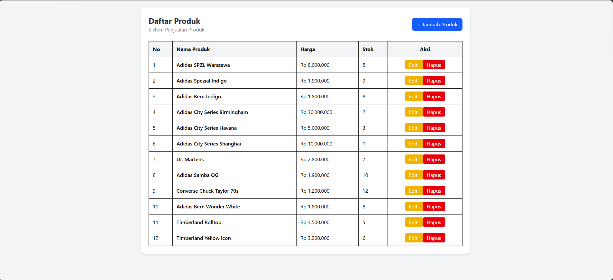
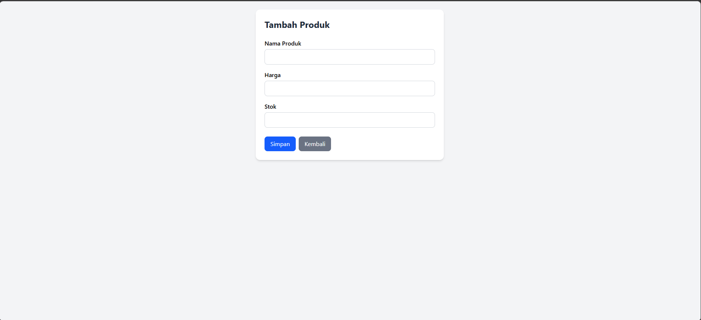
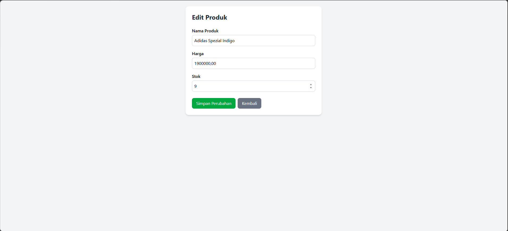
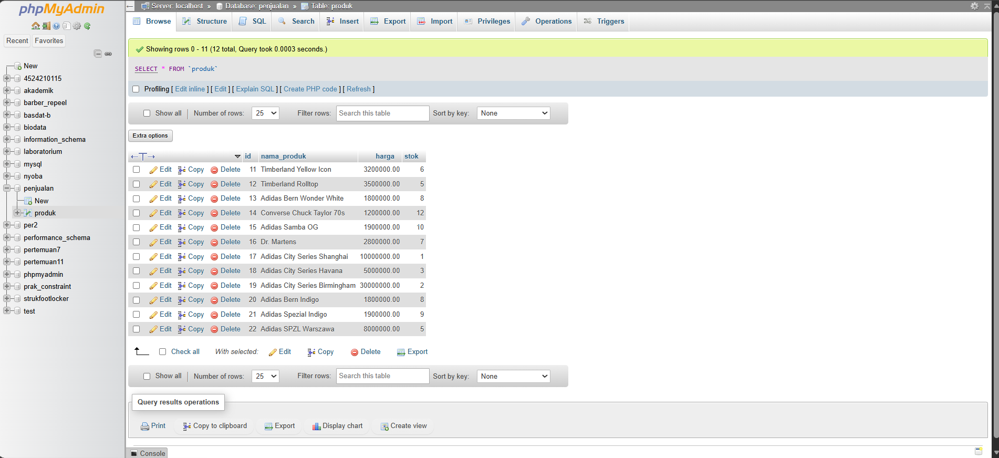

# Tugas 7 Praktikum PBW

**Nama:** Muhammad Hafiz Saputra

**NPM:** 4524210115

## Program Penjualan Produk Berbasis MVC

Pada Tugas 7 dibuat program penjualan produk sederhana menggunakan konsep **MVC (Model, View, Controller)** yang terhubung dengan database MySQL.

Program ini digunakan untuk menampilkan, menambahkan, mengubah, dan menghapus data produk.

### Struktur Program

Program terdiri dari beberapa bagian:

- **Model** (`ProdukModel.php`) digunakan untuk mengelola data produk dan berinteraksi dengan database.
- **View** (`create.php`, `edit.php`, `index.php`) digunakan untuk menampilkan halaman kepada pengguna.
- **Controller** (`ProdukController.php`) digunakan untuk menghubungkan Model dengan View dan mengatur proses program.
- **index.php** digunakan sebagai pintu masuk utama program.
- **koneksi.php** digunakan untuk menghubungkan program dengan database MySQL.

### Data Produk

Produk yang digunakan pada program berupa sepatu, yaitu:

1. Timberland Yellow Icon
2. Timberland Rolltop
3. Adidas Bern Wonder White
4. Converse Chuck Taylor 70s
5. Adidas Samba OG
6. Dr. Martens
7. Adidas City Series Shanghai
8. Adidas City Series Havana
9. Adidas City Series Birmingham
10. Adidas Bern Indigo
11. Adidas Spezial Indigo
12. Adidas SPZL Warszawa

### Fitur Program

1. Menampilkan daftar produk.
2. Menambahkan produk baru.
3. Mengedit data produk.
4. Menghapus produk.
5. Menyimpan data produk ke database MySQL.

### Penjelasan 5 Bagian Kode Penting

1. **Koneksi Database**

   File `koneksi.php` digunakan untuk menghubungkan program PHP dengan database MySQL menggunakan `mysqli_connect()`.

2. **ProdukModel**

   File `ProdukModel.php` digunakan untuk mengelola data produk seperti mengambil data, menambahkan data, mengubah data, dan menghapus data dari database.

3. **ProdukController**

   File `ProdukController.php` digunakan untuk mengatur proses program dan menghubungkan Model dengan View.

4. **View Produk**

   Folder `views/produk` berisi halaman `index.php`, `create.php`, dan `edit.php` yang digunakan untuk menampilkan daftar produk serta form tambah dan edit produk.

5. **Routing pada index.php**

   File `index.php` utama digunakan untuk menentukan proses yang dijalankan berdasarkan `action`, seperti `create`, `store`, `edit`, `update`, dan `delete`.

## Screenshot Hasil Program

### 1. Halaman Daftar Produk

Menampilkan daftar sepatu yang tersimpan di dalam database serta tombol untuk menambah, mengedit, dan menghapus produk.

### 2. Halaman Tambah Produk

Menampilkan form untuk menambahkan produk baru berupa nama produk, harga, dan stok.

### 3. Halaman Edit Produk

Menampilkan form untuk mengubah data produk yang sudah tersimpan.

### 4. Database MySQL

Menampilkan data produk yang berhasil tersimpan pada tabel `produk` di database `penjualan`.

## Kesimpulan

Program penjualan produk berhasil dibuat menggunakan konsep MVC. Model digunakan untuk mengelola data dan database, View digunakan untuk menampilkan halaman, sedangkan Controller digunakan untuk mengatur alur proses antara Model dan View. Data produk dapat ditambahkan, ditampilkan, diubah, dan dihapus melalui program.